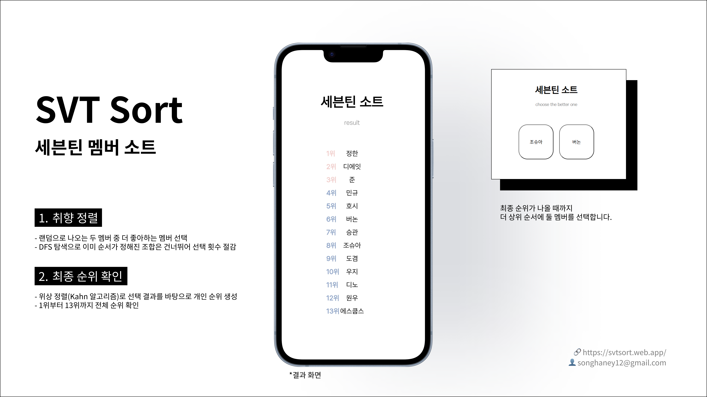

svt sort

## 🧑‍💻 프로젝트 소개

> 세븐틴 멤버 13명을 두 명씩 비교하며 개인 취향 순위를 완성하는 웹 사이트입니다.<br>
> 사용자는 랜덤으로 출력된 두 멤버 중 더 선호하는 멤버를 반복해서 선택하며 자신만의 순위를 완성할 수 있습니다.

- 프로젝트명: svt sort
- 개발 기간: 2025.06. (약 1주)
- 개발 인원: 1명 (개인 프로젝트)
- 주요 사용자: 세븐틴 팬

<br>



<br>

## 🔗 배포 주소

[서비스 바로가기](https://svtsort.web.app/)

<br>

## 🧠 동작 원리

- 승패를 "이긴 멤버 → 진 멤버" 화살표로 저장하는 **방향 그래프**를 사용합니다.
- 1이 2를 이기고 2가 3을 이기면 1과 3은 비교하지 않아도 순서가 정해지므로, **DFS(깊이 우선 탐색)** 로 화살표가 이어지는 쌍은 다시 묻지 않습니다.
- 모든 멤버의 순서가 정해지면 **위상 정렬(Kahn 알고리즘)** 로 1위부터 13위까지 순위를 만듭니다.
- 13명의 모든 쌍(78쌍)을 비교하지 않고, 시뮬레이션 기준 평균 약 39번의 선택으로 순위가 완성됩니다.
- 비교할 쌍과 좌우 위치는 랜덤으로 출제하며, 같은 멤버가 연속해서 나오지 않도록 조정했습니다.

<br>

## ⚙️ 기술 스택

- **프론트엔드**: React, JavaScript, CSS
- **빌드 도구**: Create React App (CRA)
- **기타**: GitHub, VSCode, Firebase

<br>

## 🚀 실행 방법

```bash
npm install
npm start
```
<br>

## 📈 프로젝트 성과(2026.06.19 기준)

- Firebase Hosting을 활용한 서비스 배포 및 운영
- SNS(X.com) 홍보 게시물 노출수 22만 회 달성
- 게시물 참여수 16,862회, 서비스 링크 클릭수 9,807회 기록
- 리포스트 878회를 기록하며 X 외 다양한 팬 커뮤니티로 서비스 확산